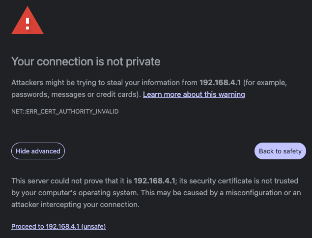
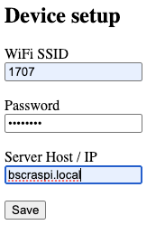

# ESP Firmware

## Device Provisioning

The ESP generates and keeps its own private key on-device. Provisioning supplies the signed client certificate and later the deployment-specific network configuration.

## Sensor Wiring

All I2C sensors share one I2C bus in this firmware. For a given device, the
configured `i2cSdaPin` and `i2cSclPin` values should therefore be the same for
every I2C sensor on that device.

## Adding a Sensor on the ESP

The ESP side is responsible for accepting the backend configuration, storing it in NVS, reading it back on boot, and using it to produce runtime sensor events.

### Device Configuration

To add a sensor configuration type, update:

- `main/config/device_config.h` for the sensor enum and config struct
- `main/config/config_service.c` for:
  - JSON parsing from backend config
  - writing the sensor fields to NVS
  - reading the sensor fields back from NVS

If the sensor needs new per-field NVS keys, add them in `main/config/app_config.h`.

### Runtime Sensor Support

After the configuration path exists, add the firmware runtime support:

- implement or extend the sensor helper in `main/sensors`
- update `main/sensors/sensor_service.c` so the sensor gets polled and its events are queued
- update `main/events/event_payload_helper.c` if the sensor emits a new payload shape

The emitted JSON payload must match the backend event schema exactly.

Interval based sensors, such as temperature, humidity, light intensity, GNSS, and
indoor location, `publishIntervalMs` is used as both the polling and event publishing interval (i.e. poll then publish).

For threshold-driven sensors such as the accelerometer and noise level sensor,
`pollIntervalMs` defines the sampling/polling interval, while `publishIntervalMs` defines the event publish interval while the threshold condition is true. While the threshold condition is false, no events are published.

### Provisioning Overview

1. Flash the device and let it boot.
2. Capture the CSR printed over serial.
3. Use the host-side provisioning tools in [`../device-provisioning`](../device-provisioning) to issue a certificate and register it in the backend database.
4. Send the signed PEM certificate to the device over serial.
5. Verify that the certificate is stored in NVS.
6. Complete AP provisioning with Wi-Fi and backend host details.

### Certificate Provisioning

Until the device has a certificate, it prints a CSR over serial based on its self-generated key pair.

Use the provisioning tools documented in [`../device-provisioning/README.md`](../device-provisioning/README.md) to:

- issue the device certificate
- insert the certificate fingerprint into `device_certificates`
- send the PEM file to the device

The backend rejects device connections unless the issued certificate is present in `device_certificates`.

#### Load the Certificate onto the ESP

1. Connect the ESP to the host over USB.
2. Confirm which port the device mounted to.
3. Check that the serial console is waiting for a certificate.
4. Close the serial monitor and send the PEM file with `send_pem.py`.
5. Reset the device and verify that the certificate was stored.

Confirm which port the device mounted to, typically under `/dev/ttyUSB*` or `/dev/ttyACM*`:

```bash
ls /dev/tty*
```

Check the serial console. The device enters a certificate intake window and prints:

```text
Paste certificate (PEM). Waiting for BEGIN (120s)...
```

After closing the serial monitor, use `send_pem.py` from [`../device-provisioning`](../device-provisioning):

```bash
# python send_pem.py {PORT} {pem_file}
python send_pem.py /dev/ttyACM0 cert/esp-02.pem
```

Reset the device to restart the intake window if needed. After the script finishes, reset once more and verify that the certificate was stored.

If you are unsure, set the `PROV_PRINT_NVS_CERT_ON_BOOT` flag, reflash the device, and confirm that the certificate is printed in this format:

```text
----- CERT FROM NVS START -----
-----BEGIN CERTIFICATE-----
...
-----END CERTIFICATE-----
----- CERT FROM NVS END -----
```

After certificate provisioning completes, the ESP automatically switches to AP provisioning.

### AP Provisioning

Once the certificate is installed, the device is considered "shippable", but it still needs deployment-specific configuration. At this stage, the device needs:

- the Wi-Fi SSID
- the Wi-Fi password
- the IP address or resolvable hostname of the backend

After receiving the certificate, the device starts a local access point automatically. The SSID and password are configured through `PROV_AP_SSID_PREFIX` and `PROV_AP_PASS`.

Current defaults:

```c
#define PROV_AP_SSID_PREFIX "SENSOR_CONF_"
#define PROV_AP_PASS "test_esp"
```

#### Provisioning Steps

1. Connect to the device AP. A network such as `SENSOR_CONF_esp-1450` should appear, where the ESP-generated name is appended to the prefix.
2. Open `https://192.168.4.1/` in a browser.
3. Accept the certificate warning and open the configuration form.
4. Enter the Wi-Fi and host details and click `save`.
5. Confirm in the browser and serial output that provisioning succeeded.

Use the `test_esp` password with the default config. Opening `https://192.168.4.1/` should show the certificate warning first:



After accepting it, enter the Wi-Fi and host details:



If the data is sent successfully, the browser should show a message like:

```text
Wifi and Server information was received. The device will stop provisioning mode in 30 s and connect to the entered Wifi and server. If there are connectivity issues, consider activating the provisioning mode again and input correct device details.
```

Check the serial output to confirm that the device connects to Wi-Fi and receives an IP address:

```text
I (2622) wifi_service: Received IP addres: 192.168.1.104
```

Once the device has an IP address, it starts sending events to the backend.

## File Naming

To make responsibilities clear, each file/module has its own type:

### Service

A service owns the lifecycle/state of a subsystem and exposes operations to the main program or other services.
It may run background tasks, but it doesn't have to. Services can use global context.

### Client

A client builds requests to external resources (web-server, etc.) and is used by a service.
It should not depend on global context. Any inputs it needs should be passed by the calling service.
Local internal state (e.g., handles, cached tokens) is OK.

### Helper

Small utility module that hides implementation complexity by wrapping dependencies with a simplified API.
A helper should not use global context.

### Config

Global state (data only) accessed by services and main program. Loading/validation logic belongs in a service.
